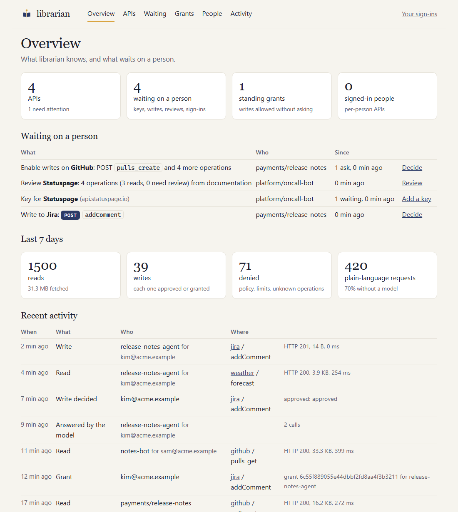
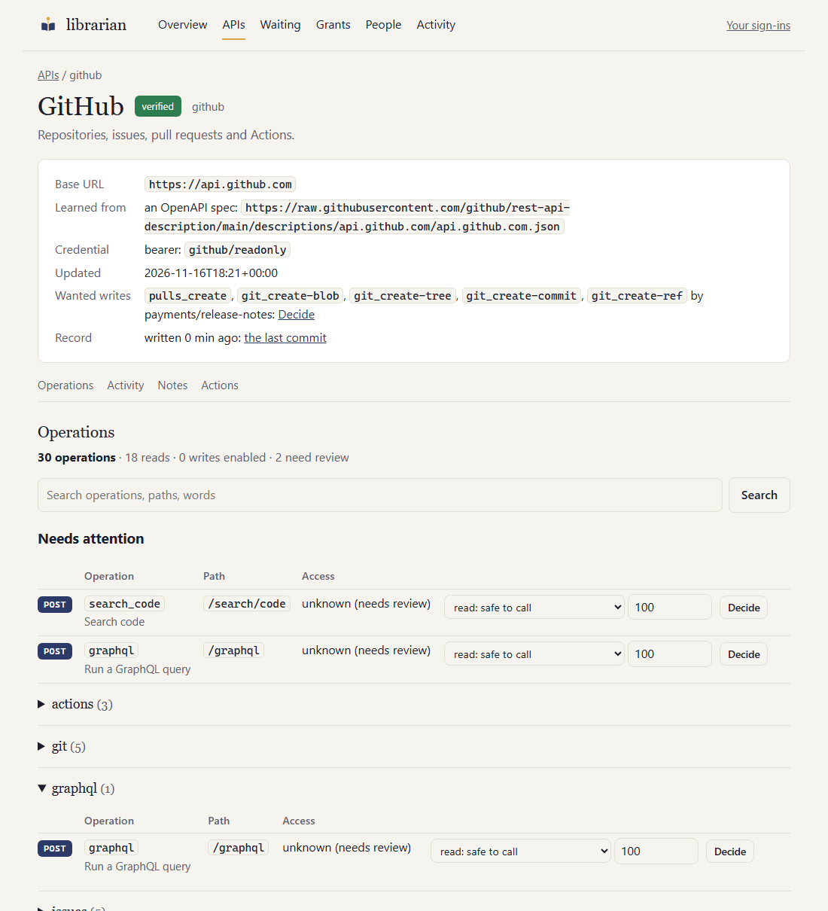
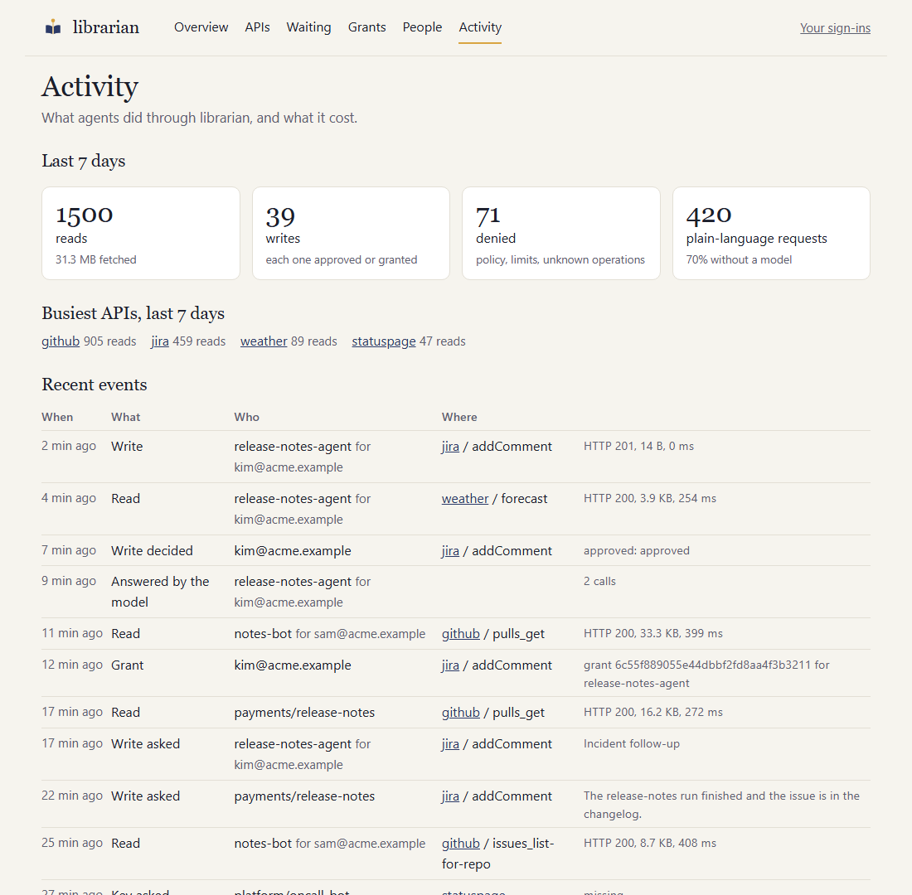
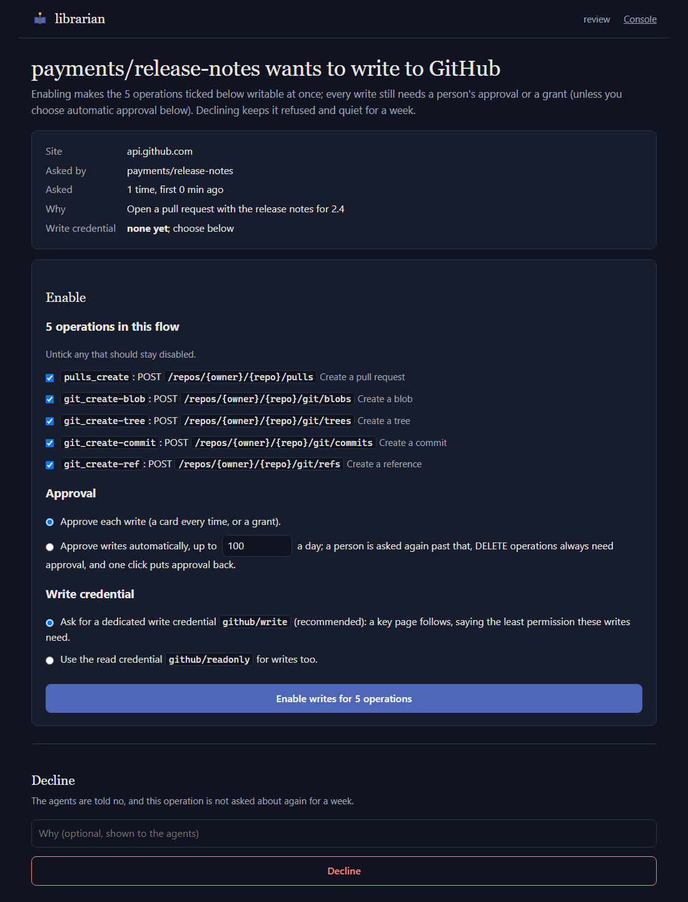
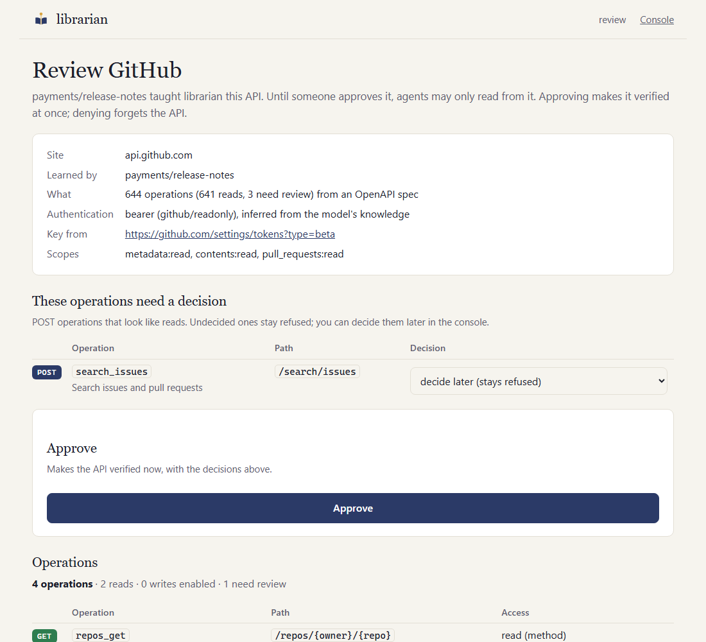
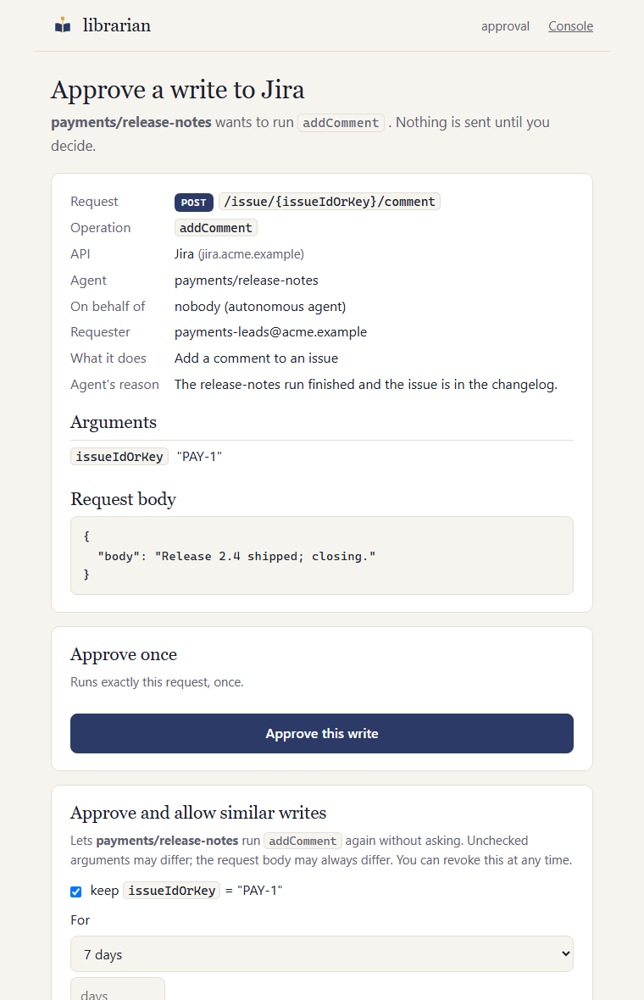
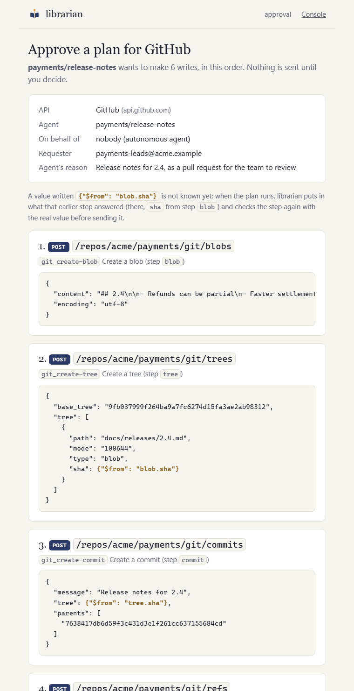

<p align="center"><a href="https://librarian-agent.com/"><picture>
<source media="(prefers-color-scheme: dark)" srcset="https://raw.githubusercontent.com/kultar/librarian/main/site/assets/banner-dark.svg">

</picture></a></p>

**An A2A agent that learns APIs on demand and gives other agents safe, audited access to them: reads freely within policy, writes only with human approval.**

Agents shouldn't each carry their own Jira token, GitHub token and API client. With librarian,
agents ask one specialist, over [A2A](https://a2a-protocol.org), for the data they need. The
librarian learns the API the first time it is needed (from its OpenAPI spec, or from its
documentation when there is no spec), asks a human for a
credential (once, out of band), and from then on serves every agent, without ever handing the
credential out.

```
 your agents ──A2A / MCP──► librarian ──(policy engine)──► Jira, GitHub, internal APIs, ...
                               │
                               ├── registry (its database): what each API is, and what people decided
                               ├── secret store: credentials (agents only ever see references)
                               ├── the record (GitHub, optional): a commit for every decision
                               └── planner (Pydantic AI, optional) ──► any model / LiteLLM
```

> Status: **alpha (v0.23)**. Expect breaking changes. Website: [librarian-agent.com](https://librarian-agent.com/).

<!-- mcp-name: io.github.kultar/librarian -->

## Why

- **One choke point.** Every call from every agent goes through one deterministic policy engine and
  lands in one audit log.
- **Credentials never travel through agents.** Secrets enter via a one-time secure page, straight
  into the secret store. Agents, messages, logs and the LLM only see references like `jira/readonly`.
  If an API sends the key back in its answer, librarian removes it first.
- **Learn once, reuse everywhere.** The first agent that needs an API triggers onboarding; every
  agent after that benefits.
- **The LLM proposes, code decides.** The optional planner can suggest any call, but only the rule
  engine (no LLM) can approve it. No prompt can talk its way into a write.
- **Decisions are made in one place.** What agents may do is decided by signed-in approvers on
  librarian's own pages and stored in its database, in effect at once. GitHub receives a commit
  for every decision and is never asked.
- **Agents can run without any key.** On [Agent Substrate and kagent](docs/integrations.md#agent-substrate-and-kagent)
  an agent's sandbox holds no credentials, not even one for librarian: the platform's gateway
  signs each call, and librarian knows which agent is calling.
- **Access is held three ways, and none of them by an agent.** A shared read-only key an
  approver adds once; a separate write credential, used only after a person approves the write;
  or, for APIs where what you see depends on who you are, each person's own OAuth sign-in,
  done once in their browser and used only for their requests (see
  [Acting as the person](#acting-as-the-person-per-person-oauth)).
- **Where the API allows it, no long-lived key is sent at all.** librarian makes what a call
  goes out with: an OAuth token that expires by itself, a GitHub App token for the one
  repository the call names (read-only for a read), or an AWS signature that fits one request
  (see [Credentials made for each call](#credentials-made-for-each-call)).

### What your agents save

- **Seven tools instead of hundreds.** An agent with direct access to an API carries that API's
  tool definitions in its context on every request (GitHub's spec has 1,242 operations). Through
  librarian an agent sees seven tools and asks `capabilities` for the handful it needs.
- **Learning is paid once.** Reading an API's documentation, searching for it and extracting its
  operations is the expensive model work. It runs once per API, with a model of your choice
  (`learning.model`), then serves every agent.
- **Most calls use no model at all.** `execute` with a known operation is plain code: policy
  check, HTTP call, provenance. Plain-language `fetch` costs one planner call, and a successful
  plan is saved as a recipe and replayed without the model next time.
- **Smaller answers.** Field selection and a response-size cap return the fields an agent asked
  for, not a whole payload into its context; pagination is handled on librarian's side.
- **Operations exist once.** Credentials, rotation, retries, change detection and the audit
  trail live in one place instead of in every agent.

What it does not shrink is an agent's own reasoning: librarian removes the overhead around the
call, not the thinking before and after it. The audit log records every call with its byte count
and whether a model was involved, so a week of real traffic shows the split.

## Get started

| I want to... | Go to |
|---|---|
| Try it on my laptop (10 minutes, Docker) | [docs/getting-started.md](docs/getting-started.md) |
| Try it with kagent (10 minutes, a kind cluster or your own) | [examples/kagent](examples/kagent) |
| Run it for my team (Kubernetes, step by step) | [docs/deploy.md](docs/deploy.md) (no internet exposure needed: [network](docs/deploy.md#network-what-must-reach-what)) |
| Connect agents (LiteLLM, agentgateway, kagent and Agent Substrate, MCP clients, A2A) | [docs/integrations.md](docs/integrations.md) |
| Fix something | [docs/troubleshooting.md](docs/troubleshooting.md) |

```bash
pip install librarian-a2a                  # the CLI and import are `librarian`
uvx librarian-a2a serve                    # or run it without installing (same CLI)
docker pull ghcr.io/kultar/librarian:0.23.1
```

### What happens on a request

1. An agent asks for data from an API librarian doesn't know yet.
2. librarian learns it: from its OpenAPI spec, else its documentation (found by itself if
   needed), else the model's knowledge. The API is usable for reads at once, and approvers are
   asked to review it: approving makes it verified, there and then.
3. If the API needs a key, the agent's task waits and approvers get a Slack card. Someone follows
   the link, signs in and adds the key (it goes straight to your secret store), and the task
   carries on by itself. If the API needs the *person's own* sign-in (OAuth), the person
   behind the agent gets the link instead, signs in to the provider once, and every later
   request for them carries their own token.
4. Writes wait for a person's approval every time, unless a narrow, expiring grant covers them
   or an approver chose automatic approval for that operation (capped per day, never DELETE).
   A write nobody has enabled yet is not refused silently: approvers are asked to enable it,
   from Slack or the console, and their decision is in effect at once.

Nothing is set up per API in advance: the registry fills itself as agents need things.

**Where decisions live.** librarian's database is the source of truth: every API it knows and
every decision a person made about it (approved, writes enabled, blocked) is saved there and is
in effect on every replica the moment it is made. So that this also lives somewhere outside the
database, librarian can write each approved entry and each later decision to a GitHub
repository, one commit per decision, saying who decided ([the record](#the-registry)).
GitHub is written to, never asked: nothing merged or edited there changes what agents may do.

## Skills (A2A)

| Skill | What it does | LLM? |
|---|---|---|
| `execute` | Run one read operation: `{"skill":"execute","api":"jira","operation":"getIssue","args":{"issueIdOrKey":"ABC-1"}}`. Optional `select` (dotted paths, e.g. `["fields.summary"]`) and `max_pages` | No |
| `capabilities` | List APIs and read operations, each with the arguments it takes (`args`; `team?` may be left out): `{"skill":"capabilities","query":"issues"}`, with `"api":"jira"` that API alone, and with `"api"` and `"operation"` that operation in full, with what its body holds. An agent that may ask for writes on an API also gets its `write_operations`, each with whether writes through it are `enabled`. An answer too large for an agent's context is shortened and says how to see the rest ([more](#big-apis)) | No |
| `onboard` | Learn an API: `{"skill":"onboard","api":"jira","spec_url":"https://..."}`, `"base_url"` to auto-discover, or `"docs_url"` + `"base_url"` when there is no spec | No |
| `write` | Change data, with human approval or a grant: `{"skill":"write","api":"jira","operation":"addComment","args":{...},"body":{...},"reason":"why"}`. Optional `idempotency_key`: a repeat returns the first result instead of running again. The answer says how it ran (approved by whom, under which grant, or automatically) | No |
| `plan` | Several writes on one API, approved as one and made in order: `{"skill":"plan","api":"github","reason":"why","steps":[{"id":"blob","operation":"...","args":{...},"body":{...}}, ...]}`. A later step takes a value an earlier one returned with `{"$from":"blob.sha"}` ([more](#several-writes-as-one-plan)) | No |
| `fetch` | Plain language: *"open bugs assigned to the payments team"* (only when a model is configured) | Yes |

The same skills are available as **MCP tools** at `/mcp` (Streamable HTTP, same caller keys):
`capabilities`, `execute`, `fetch`, `write`, `write_plan`, `write_status`, `enable_status`,
`onboard`. MCP calls do not wait on a human unless the agent asks: writes and plans return
`pending_approval` and librarian finishes them once approved (`write_status` reports where a
write stands and, once run, its result dated as of execution; for a plan, every step), or
`write_not_enabled` when nobody has enabled that operation yet (approvers are asked;
`enable_status` says where the request stands). An agent that wants the outcome within its
turn asks `write_status` with `wait_seconds`: it answers as soon as the write has ended, or
after that time (at most `mcp_max_wait_seconds`, 50) with where it stands. librarian
works behind the **LiteLLM** and **agentgateway** gateways as both an MCP server and an A2A
agent, and as the tool server of **kagent** agents: see
[Gateways and agent platforms](#gateways-and-agent-platforms).

Results are A2A artifacts with the data plus **provenance**: which API and operation, the URL
(secrets redacted), when, for which calling agent and principal, and which credential reference.

When a credential is missing, the task enters A2A's `TASK_STATE_AUTH_REQUIRED`, approvers are
notified (Slack by default), and the task **resumes on its own** once someone adds the key. The
caller polls or subscribes to the task as usual.

## Configuration

Settings come from a YAML file (`--config`) and/or `LIBRARIAN_*` environment variables (env wins;
nested keys use `__`, e.g. `LIBRARIAN_NOTIFIER__SLACK__BOT_TOKEN`). Every setting is listed
under [Settings](#settings); [`examples/librarian.yaml`](examples/librarian.yaml) is a
commented example.

**Models / LiteLLM.** `fetch` needs a model. Use any Pydantic AI model string
(`model: anthropic:claude-sonnet-5-5`, with the provider's usual API-key env var), or point at any
OpenAI-compatible gateway such as LiteLLM:

```yaml
model: claude-sonnet-5-5            # the model name your gateway serves
model_base_url: http://litellm:4000/v1
model_api_key: sk-litellm-...       # or LIBRARIAN_MODEL_API_KEY
```

**Secrets.** Choose a backend with `secrets_backend`:

- `file` (default): one `0600` file per secret, good locally or on a mounted volume.
- `aws`: AWS Secrets Manager (`uv sync --extra aws`). `jira/readonly` maps to the secret
  `<prefix>jira/readonly`; append `#key` to read one key of a JSON secret
  (`service/jira#api_token`). Values are cached briefly (`aws_secrets.cache_seconds`).

Environment variables are always checked last (`jira/readonly` → `LIBRARIAN_SECRET_JIRA_READONLY`).
Internal secrets (caller keys, the link-signing key) live under the reserved `librarian/` prefix.

**Internal APIs.** URLs that agents supply (onboarding) and the entries learned from them may
only reach public addresses, so no agent can point librarian at your network. List the internal
domains agents may learn on demand:

```yaml
internal_hosts: ["*.internal.example.com", "jira.corp"]   # or LIBRARIAN_INTERNAL_HOSTS='["*.internal.example.com"]'
```

A matching host may resolve to private addresses (never loopback or link-local, i.e. cloud
metadata), with the same DNS pinning as public hosts; everything else stays public-only. The
review page and the audit log say when an API was learned under one of these patterns.
`allow_private_networks: true` allows everything and is for a laptop.

**State.** The registry (every API and the decisions made about it), credential requests,
approvals and A2A tasks are stored in SQLite by default (`.librarian/librarian.db`), so they
survive restarts. For several replicas use
Postgres (`database_url: postgresql+asyncpg://...`, the `postgres` extra; in the image) and
`secrets_backend: aws`: then every replica shares everything, an API learned through one is usable
through the others at once, and pods need no volume. Set `replicas` (the Helm chart does) and
librarian refuses to start with per-replica state. Rate limits are counted in the database
too, so every replica enforces the same limit together.

**Writes and plain-language requests.** `fetch_timeout_seconds` (100) stops a plain-language
request and returns what it has, marked partial, before the caller's own timeout;
`max_calls_per_fetch` (8) caps its API calls.

**Caller authentication.** List agents and the secret holding each one's key:

```yaml
callers:
  - agent: release-notes-agent
    key_ref: librarian/callers/release-notes-agent   # internal secrets live under librarian/
    apis: ["jira", "github-*"]                       # glob patterns; default ["*"]
    can_onboard: false                               # may this agent teach new APIs?
```

An agent only sees and uses the APIs its patterns allow, in `capabilities`, `execute` and `fetch`.

With no callers configured the server is open: fine on a laptop, never in a shared deployment.

Agents running on [Agent Substrate](https://github.com/agent-substrate/substrate) or kagent need
no key at all. Their sandboxes hold no credentials; the platform's egress gateway puts a signed
token naming the agent into each request, librarian verifies it against the cluster's issuer,
and a rule says what that agent may do:

```yaml
substrate:
  issuer: https://idp.ate-system.svc
  kagent_url: http://kagent-controller.kagent.svc:8083
  rules:
    - match: {namespace: payments}
      write_apis: [github]
      owner: payments-leads@example.com
    - match: {}                           # every other agent: reads and learning
```

See [integrations](docs/integrations.md#agent-substrate-and-kagent); the Helm chart sets it up
with `substrate.enabled`.

## Gateways and agent platforms

librarian is one more server behind whatever already carries your agents' traffic.
[docs/integrations.md](docs/integrations.md) has the configuration, and the last column says
how each is tested:

| | What works | Tested |
|---|---|---|
| **[LiteLLM](docs/integrations.md#litellm-agent-gateway)** | librarian as an MCP server and an A2A agent behind the gateway, which holds one key for librarian; LiteLLM as librarian's own model gateway | Every week against a real LiteLLM (`tests/integration/litellm`), and in a real deployment |
| **[agentgateway](docs/integrations.md#agentgateway)** | librarian as an MCP server and an A2A agent behind it, two ways: each agent's own key passes through, or the gateway signs people in and librarian checks the same token itself. On Kubernetes the Helm chart attaches librarian to your Gateway (`agentgateway.enabled`) | Every week against agentgateway v1.7.0 (`tests/integration/agentgateway`); the chart option by hand on kind |
| **[kagent and Agent Substrate](docs/integrations.md#agent-substrate-and-kagent)** | Agents call librarian's tools with no key of their own (above); the chart registers librarian as a `RemoteMCPServer`. Rules per Agent, plans, a subset of the tools per agent, kagent's own approval in front of librarian's | By hand, not on a schedule: [the ten-minute path](examples/kagent) on 2026-11-17 with kagent 1.0.1 and Agent Substrate 1.0.0 on kind, and [a longer run](tests/integration/substrate) before it. With every commit: the token checks and the rules, against a stand-in. [What is and is not tested](docs/integrations.md#how-this-is-tested) |

Three things keep it well-behaved behind any of them:

- **An answer never breaks on the way.** Gateways and MCP clients stop at a megabyte or two
  and say only that a message could not be sent. A tool result that large is never sent: the
  agent gets the answer's outline and asks for less (`mcp_max_result_bytes`, under
  [Big APIs](#big-apis)).
- **The first answer fits in an agent's context.** `capabilities` is what an agent asks
  first, and agent clients warn about a tool result of tens of thousands of tokens, put it
  aside in a file, or refuse it. Its answer stays under `capabilities_max_bytes` however many
  APIs there are, and says how to see what it left out ([Big APIs](#big-apis)).
- **An agent can wait for a person.** Where nothing can wake an agent when an approval
  arrives (a kagent session, a chat turn), it asks `write_status` with `wait_seconds` and has
  the outcome in the same turn (`mcp_max_wait_seconds`).

Two things help an agent find librarian and use it well:

- **A skill.** [`skills/librarian`](skills/librarian/SKILL.md) is an Agent Skill: one
  `SKILL.md` that tells an agent how to read through librarian, how to ask for a change and
  wait for the person, and what to do with each answer (`too_large`, `pending_approval`,
  `write_not_enabled`, a refusal). It is in librarian's image as well, which is where a
  kagent Agent takes it from, by digest ([integrations](docs/integrations.md#the-skill)); any
  harness that reads Agent Skills can use the folder.
- **The MCP Registry.** librarian is listed in the
  [MCP Registry](https://registry.modelcontextprotocol.io) as `io.github.kultar/librarian`,
  from [`server.json`](server.json), with every release: the PyPI package
  (`uvx librarian-a2a serve`) and the image, each serving MCP at `http://127.0.0.1:8080/mcp`.

Through kagent librarian knows the agent, not the person behind it (kagent sends an MCP server
one or the other). A rule's `owner` approves that agent's writes; APIs that use each person's
own sign-in, and "only the requester may approve", need a person and do not work there yet.
What kagent can add is the signed-in user's name in a header nothing signs. With
`substrate.claimed_user_header: X-User-Id` librarian shows it to the approver and records it,
worded as what it is ("the agent's platform names kim@example.com: nothing signs that"), and
uses it for nothing else.

## Observability

Set `otel_enabled: true` (install the `otel` extra; the Docker image has it) and the standard
`OTEL_EXPORTER_OTLP_ENDPOINT`. You get:

- **Traces**: `librarian.skill` and `librarian.call` spans (plus the A2A SDK's and Pydantic AI's
  model-call spans). A calling agent's `traceparent` is honoured, so its trace continues through
  the librarian. Trace headers are **never** forwarded to third-party APIs.
- **Metrics**: `librarian.api.calls` (by API, operation, caller, status class),
  `librarian.api.call.duration`, `librarian.policy.denials`, `librarian.credential.requests`.

The JSONL audit log is separate and always on.

## Big APIs

- **Operation search.** Requests are matched to operations with BM25 ranking over operation ids
  (split into words: `getIssueWatchers` -> issue, watch), tags, paths and summaries. On Jira's
  620-operation API, "who is watching an issue" finds `getIssueWatchers` first.
- **What `capabilities` lists.** With a `query`: the ten APIs that fit it best, and of each
  the 20 best-matching reads (and the 20 best-matching writes, where the agent may ask for
  writes). Without one: every API the agent may use, with the first 50 of each. With `api`:
  that API alone. Each operation comes with the arguments it takes, and
  `total_read_operations` and `total_write_operations` say how many there are. On GitHub's
  API, an answer to a query is about 3 KB for an agent that only reads and 7 to 8 KB for one
  that may also ask for writes.
- **What a request body holds.** An agent that is told only that an operation takes a body
  has to guess what goes in it: from what it knows of a public API, from nothing for an
  internal one. librarian reads it from the API's description and tells it. Where
  operations are listed, each names the first fields of its body: `"body": ["head", "base",
  "title?", "labels?", "author.name?"]` (`?`: may be left out; a dot: a field inside
  another), with `body_more` when there are more than ten. It does so always when asked
  about one API (`api`), and among several APIs where the whole answer has room for it: a
  few small APIs are told with it, and among large ones an operation says `body: true`
  there. Asked about one operation
  (`api` and `operation`), it gets all of it: every argument with its type and description,
  and every field of the body with its type (`list of string` for a list), the values it
  takes and what it is for (up to 40 fields, three levels deep). A field is named by the
  keys that lead to it, as an agent writes them: where `items` is a `list of object`,
  `items.price` is the price of each item. Nothing is checked against this: the API accepts or refuses
  a body, and descriptions leave fields out. `body: true` says only that the operation takes
  a body: in a list because the names had no room there, and asked about the one operation
  because its description does not say what is in it. Three limits to know:
  - It is read from OpenAPI and Swagger descriptions, not from documentation pages or a
    model's knowledge, and you can write it into an entry by hand
    ([the format](docs/registry.md)).
  - An API learned before 0.23 gets it when its description next changes, or at once when a
    person asks: *Re-check now* on the console's API page, or `librarian registry recheck
    <api>`. For an approved API that is an update an approver takes, like any other; it
    touches nothing else about the operations.
  - A body is sent the way the description says the API takes it: as JSON, or as a form
    (`application/x-www-form-urlencoded`: Stripe's API, for every operation). The agent gives
    an object either way. In a form, a field inside another goes in brackets
    (`metadata[order]=6735`) and a list is written as that API's description writes lists
    (`tag=a&tag=b`, `tag[0]=a&tag[1]=b` or `tag=a,b`). The answer says `"sent_as": "form"`, and
    the approval page shows the fields as they go over the wire. A multipart body (a file
    upload) is not something librarian sends: the answer says so.
- **An answer that fits in an agent's context.** `capabilities` is the first thing an agent
  asks, and all of it goes into the agent's context. The answer stays under
  `capabilities_max_bytes` (16,000 bytes of JSON: over MCP up to about 28,000 characters of
  text, some 9,000 tokens for a Claude model). When it would be larger, the lists of
  operations are cut, to the same length for every API, and a `note` in the answer says what
  was left out and how to see it: `capabilities` with `api` for one API, and with a query
  for the operations that fit. Every API is still there with how many operations it has.
  With a query, the API that fits it best keeps its matches and the others are cut. Past a
  few dozen APIs not all of them fit even without operations: the first ones are listed and
  `more_apis` has the ids of the others. `capabilities_max_bytes: 0` lifts the limit (over
  MCP, `mcp_max_result_bytes` still holds: the lists are cut to that).

  Measured on five large APIs (GitHub, Stripe, Jira, PagerDuty and DigitalOcean: 3,911
  operations) for an agent that may ask for writes and gives no query: the answer was
  120,000 characters of text over MCP (39,000 tokens) and is 26,000 (8,500), with ten reads
  and ten writes for each API. Claude Code, for one, warns about a tool result of more than
  10,000 tokens and puts text of more than 50,000 characters into a file instead of the
  context.
- **Answers an agent can take.** `select` keeps only the fields an agent names
  (`["issues.key", "issues.fields.summary"]`). Over MCP, an answer that would make a tool
  result of more than `mcp_max_result_bytes` (1 MB as sent, about 480 KB of data) is not
  handed over at all: megabytes are no use to a model, and MCP clients and gateways on the
  way refuse them with errors that say nothing. The agent gets `too_large` with an
  **outline** instead (the fields, how many items a list has), and asks again with `select`.
- **Glossary.** Registry entries can declare `discovery` reads that teach instance-specific
  names, e.g. Jira's `/field` maps `customfield_10020` to "Sprint". They run after a credential
  is approved (or `librarian discover <api>`), and the planner sees the relevant entries.
- **Recipes.** A successful plain-language request is saved as a template: "Is PAY-1 open?"
  becomes `Is {p0} open`, and "Is PAY-7 open?" later replays the same calls **without the LLM**
  (still policy-checked, with the caller's permissions). Requests whose later calls use values
  from earlier results are never saved. `librarian recipes list|delete`; `recipes_enabled: false`
  turns it off.

## APIs without a spec, and APIs that change

**Learning without a spec** (needs `model`; set `learning.model` to use a stronger model for
learning only, since that happens once per API while `fetch` runs on every request;
`fallback_model` is tried once when a model fails or declines a request). librarian learns
from, in order of preference:

1. **An OpenAPI spec**: given, found at a well-known path, or linked from the docs.
2. **Documentation pages**: the model reads the page and related pages on the same site and
   lists the operations, each with a verbatim quote. librarian checks every quote against the
   fetched page and drops operations it can't find there. With only a `base_url`, librarian
   **finds the docs itself**: the usual places first (`/llms.txt`, `/docs`, `docs.<domain>`,
   links on the homepage, one click further), then a **web search** if configured.
3. **The model's own knowledge** (nothing found): reads only, for well-known APIs.

Search results are untrusted (anyone can publish "Acme API docs"), so sources are ranked:
the API's own domain first, then well-known docs hosts (GitHub, ReadMe, GitBook, ...);
other sites are skipped unless `learning.search.allow_third_party: true`. The entry's notes
(shown on the review page) say how the docs were found and how far they are trusted.

```yaml
learning:
  search:
    provider: model        # off | model | searxng | brave
    # url: https://searx.internal          (searxng)
    # api_key: via LIBRARIAN_LEARNING__SEARCH__API_KEY   (brave)
```

`provider: model` uses the model's own web search. Through a gateway such as LiteLLM that
needs the Anthropic API format (`model_api: anthropic`); with the OpenAI formats the search is
refused or silently dropped by the gateway, and librarian reports that instead of guessing.

**Specs that declare no authentication** are common even for APIs that need a key (GitHub's
does). librarian then asks the model what the API really uses and writes it into the entry,
for approval. Approvers never edit YAML: the review is approve or deny, and anything that needs
a person's choice (the authentication, when the model can't tell) is a choice in the console.
If such an API answers 401 later, librarian infers the authentication then and asks for a key;
for a verified entry it tells the approvers what it thinks, and they choose in the console.

Documentation is untrusted, so the model never decides anything that matters: it has no tools;
the API host is always the `base_url` you gave (never one from the docs); read vs write is decided
by HTTP method; the auth *type* may come from the docs but where the key is stored never does.
Operations from docs or model knowledge are **unconfirmed** until a real call succeeds (callers
see a warning). One that keeps answering 404 is **suspended** and its owners are told.

```bash
uv run librarian learn dogs --docs-url https://dog.ceo/dog-api/documentation/ \
    --base-url https://dog.ceo/api --name "Dog CEO"
```

**Noticing changes.** Every `drift.recheck_hours` (default 24), one replica re-reads each entry's
spec or docs. A new model read only happens when the docs' text actually changed.

| Change | Provisional entry | Verified entry |
|---|---|---|
| New operations, optional parameters | updated | an update waits for an approver |
| Removed operation, new required parameter, moved path | updated | callers warned; writes **suspended**; an update waits |
| HTTP method changed (a read may now change data) | updated | **suspended**; an update waits |

Verified entries are never changed automatically. Approvers get a card and a page listing what
changed; approving applies the update, keeping the decisions people made (writes enabled,
reviewed reads, pagination) wherever the operation is still the same request, and lifts the
suspensions it addresses. Denying keeps the entry as it is.

Calls also watch for change: `Deprecation`/`Sunset` headers, repeated 404/405/410 responses, and
responses that lose most of the fields seen before are reported to the API's owners (once), and
callers see a warning. `librarian registry recheck [api]` runs a check now;
`librarian registry clear <api> <operation>` lifts a suspension after checking by hand.

## When an API misbehaves

APIs fail in ways an agent cannot act on by itself. librarian turns each into something it can:

- **No answer.** When an API cannot be reached or does not finish answering, the agent is told
  so in words, with the reason when there is one (the name did not resolve, the connection was
  refused, its certificate was not accepted, it did not answer in time): *"Jira gave no answer:
  it could not be reached (its host name did not resolve). Nothing was read: retry later."* For
  a write the message ends with what matters most: *"The write was not sent"*, or *"The write
  may have reached it: check before sending it again."*
- **A time limit for the whole request.** Connecting, and each wait for the next part of an
  answer, may take `request_timeout_seconds` (30); one request as a whole twice that, however
  slowly the answer trickles in. An answer longer than `max_response_bytes` (2 MB) is cut off
  and marked `truncated`.
- **An answer is passed on as data only if everything after librarian can handle it.** JSON
  nested deeper than 100 levels, cut off, or not parseable arrives as text; `NaN` and
  `Infinity`, which are not JSON, become `null`.
- **A credential the API sends back is removed** from the answer (`[redacted]`) before it
  reaches the agent, a model, the audit trail or the stored result of a write.
- **A write always ends.** Once librarian has taken an approved write to send it, its approval
  reaches a final state that says what happened: the API's answer, "not sent", "may have
  reached the API", or, when the replica stopped in the middle, "interrupted" (closed after 15
  minutes, or ten times the request timeout if that is longer, and never sent again by
  librarian). A repeat with the same `idempotency_key` is refused while the first is open.

**`librarian doctor`** checks that no credential is stored where it must not be. It compares
every credential in the secret store with every row of the database and every line of the
audit file, in each form a credential can take there, and names what it finds by the secret's
reference; it never prints one. `--redact` replaces the copies in the database. Versions before
0.20 could store one, so run it once after upgrading from them
([more](docs/troubleshooting.md#agents-and-calls)).

## Acting as the person (per-person OAuth)

Some APIs have no credential that is right for everyone: what Google Drive or Jira returns
depends on who is asking. For those, librarian is the OAuth client and each person signs in
once:

```yaml
# in the registry entry (verified entries only)
auth:
  type: oauth2_user
  authorization_url: https://accounts.example.com/o/oauth2/auth
  token_url: https://oauth2.example.com/token
  scopes: [files.read]
  client_id: "<the OAuth client you registered for librarian>"
  client_secret_ref: drive/oauth-client          # in the secret store; omit for a public client
  extra_authorize_params: {access_type: offline, prompt: consent}   # provider extras
```

Register librarian with the provider once, with the redirect URI `<public_url>/oauth/callback`.
For GitHub, `librarian github-app create --oauth-callback <public_url>/oauth/callback` creates
an App that is also the OAuth client and saves its client secret next to the key (GitHub Apps
use the App's permissions, so `scopes` stays empty).
The first time a person's agent needs the API, that person (not the approver group) gets a
one-time link, by Slack direct message when Slack knows their address: they sign in to the
provider in their browser and librarian stores their tokens under `<api>/users/<hash>`. From
then on every request their agents make for them carries their own token, so the API enforces
their access and librarian's policy applies on top. Tokens are refreshed by librarian; a
rejected or expired sign-in simply asks the person again. Agents never see the tokens, and a
request for person B can never go out with person A's token (recipes and credentials are kept
per person). The console lists who is signed in to what and can disconnect them.

With `principals.mode: required` the person must be verified by your identity provider before
their token is used; with `off` (a laptop) the agent's claimed principal is trusted. Requests
with no person behind them are refused for these APIs. MCP callers get `consent_pending` while
the person signs in.

## Credentials made for each call

A stored key is the same key for every call until someone replaces it: whoever gets hold of
it has everything it can do. Three kinds of authentication avoid sending such a key to an API
at all. librarian makes what each call goes out with, keeps it until shortly before it expires,
and removes it from the answer like any other credential.

```yaml
# OAuth 2.0 client credentials: the API gets a token that expires by itself. The client
# secret is stored, and goes to the token endpoint only.
auth:
  type: oauth2_client
  secret_ref: ledger/client          # the client secret, in the secret store
  token_url: https://login.example.com/oauth2/token
  client_id: librarian
  scopes: [ledger.read]              # give writes their own under write_auth
  # audience: https://ledger.example.com   # where the provider wants one
  # client_auth: basic                     # id and secret as HTTP basic instead of in the form

# A GitHub App instead of a personal token: a token for each call, valid for an hour,
# limited to the repository the call names, and read-only when the call is a read.
auth:
  type: github_app
  secret_ref: github/app-key         # the App's private key (PEM), in the secret store
  app_id: 123456
  # installation_id: 987654321       # for operations that name no owner (/user, search)
  # permissions: {contents: read}    # ask for exactly these instead of what is installed

# AWS Signature Version 4: every request is signed; there is no key to store.
auth: {type: aws_sigv4, service: execute-api, region: eu-west-1}
write_auth:                          # writes as a role assumed for this API, for 15 minutes
  type: aws_sigv4
  service: execute-api
  region: eu-west-1
  role_arn: arn:aws:iam::123456789012:role/orders-writer
```

Set them in the console (an API's page, *Authentication*, *Describe it in full*) or in a
registry file; only an approved entry may use them, because they say where a secret is sent
and whose identity is used. `write_auth` takes the same shapes, so reads and writes can have
different scopes, permissions or roles. When writes are enabled on an API that reads this way,
nobody is asked for a write key: a write is authenticated the same way, and a read still never
gets a token that can write.

- **GitHub**: create an App with the permissions your agents need, install it on the
  repositories they may touch, and store its private key. For a read, librarian asks GitHub
  for a token with every permission turned down to `read`; GitHub itself then refuses a write
  made with it. Works with GitHub Enterprise Server (the entry's `base_url`).
- **AWS**: without `role_arn`, requests are signed with librarian's own identity (the role
  of its pod). With it, librarian assumes that role first: let its pod role
  `sts:AssumeRole` only the roles your entries name, and give each role only what that API
  needs. `service` is the signing name (`execute-api`, `s3`, `es`, `lambda`, ...). Needs the
  `aws` extra, which the image has.
- **When it does not work**, the agent is told what to have fixed (a scope, where the App is
  installed, a role librarian may not assume) and no approver is asked for a key that would not
  help. A client secret or App key that is refused is asked for like any other key.

## Limits inside an API

`apis` and `write_apis` say which APIs an agent may use. `limits` says what it may do inside
one: which operations, and which values its arguments may take.

```yaml
callers:                                   # the same under substrate.rules
  - agent: release-notes
    key_ref: librarian/callers/release-notes
    apis: [github, jira]
    write_apis: [github]
    limits:
      github:                              # an API id (a glob pattern)
        arguments:
          owner: [acme]                    # only acme's repositories...
          repo: ["payments-*", docs]       # ...and only these (glob patterns)
        allow_without: [meta_get]          # an operation that takes neither argument
      jira:
        operations: ["get*", "search*"]    # only these operations
        arguments: {projectIdOrKey: [PAY]}
```

An operation may be called when it takes at least one of the limited arguments and every one
it takes is given with an allowed value. An argument the API treats as optional must then be
given: left out, the answer would cover everything. An operation that takes none of them (a
search across the whole site, "who am I", GraphQL) cannot be held to anything, so it is
refused unless `allow_without` names it. The policy engine decides this for reads, writes and
the planner's calls alike; a write outside the limits is refused, not put to an approver, and
no standing grant reaches past them. `capabilities` shows an agent only what it can reach,
and tells it its limits.

Matching is exact and case-sensitive, and only arguments are looked at: what a request
body says (a pull request's `head`, a JQL query) is not. Use a credential that cannot do more
where that matters; with a [GitHub App](#credentials-made-for-each-call) the token itself is
for the one repository the call names.

## Verified principals

By default the person an agent acts for (`principal`) is whatever the agent claims. Turn on
verification to require proof: the agent sends a token from your identity provider in the
`X-Principal-Token` header, and librarian checks its signature (issuer's published keys), issuer,
audience and expiry.

```yaml
principals:
  mode: required          # off | optional | required
  issuers:
    - issuer: https://acme.okta.com/oauth2/default
      audience: librarian  # tokens must be minted for librarian
      claim: email
```

- `optional`: verified when a token is present; a claimed principal without one is recorded
  but does **not** count as the requester for write approvals.
- `required`: a claimed principal without a valid token is refused. Requests with no person
  behind them (autonomous agents) still work.

Verified identities appear in provenance (`principal_verified: true`) and the audit log. How an
agent gets a token for librarian on a user's behalf is covered in
[docs/integrations.md](docs/integrations.md#verified-principals).

## Slack notifications

1. Create a Slack app from [`deploy/slack-app-manifest.yaml`](deploy/slack-app-manifest.yaml) and
   install it to your workspace.
2. Set `notifier.type: slack`, the bot token (`LIBRARIAN_NOTIFIER__SLACK__BOT_TOKEN`), a channel,
   and optionally an approver user-group ID (rendered as a real @mention).

Every API learned on demand gets a **review card**: what was learned, the authentication it
will use, anything to check, and a **Review** button that opens a signed-in page where an
approver sees what was learned, decides any operations that need it (read, write or exclude),
and **approves** (the API is verified at once, on every replica) or **denies** (the API is
forgotten). The card is updated with the outcome and who decided.
Approvers also get one card per API that needs a key (deduplicated, with a live "waiting"
count) and a **Review request** button that opens the secure page: *add a key*, *use an existing secret*, or *deny*. The card
updates in place and the outcome is posted in the thread. The key itself never goes through Slack.

No Slack? `notifier.type: webhook` posts JSON events you can route anywhere.

## What it looks like

<p align="center">
<br>
<em>The console: what librarian knows, and what waits on a person.</em>
</p>

<p align="center">
<br>
<em>A large API: search, the operations that need a decision first, then groups by tag.</em>
</p>

<p align="center">
<br>
<em>Activity: what agents did, and what it cost.</em>
</p>

<p align="center">
<br>
<em>An agent wanted a write nobody had enabled: the approver enables the whole flow, chooses how writes are approved and where the write credential comes from.</em>
</p>

<table align="center"><tr>
<td></td>
<td></td>
</tr><tr>
<td align="center"><em>Approving a learned API, from the Slack card.</em></td>
<td align="center"><em>Approving one write: exactly what will be sent.</em></td>
</tr></table>

<p align="center">
<br>
<em>Approving a plan: a commit and its pull request are six requests and one decision.</em>
</p>

## The console

The pages listener's root (`/`) is a console for the people who run librarian, with pages for
the overview, the APIs (status, host, operations and where they were learned from), what is
waiting on a person (keys to add, writes to approve or enable, learned APIs and updates to review, sign-ins), the
standing grants, the people signed in to per-person APIs, each person's own sign-ins, and
**activity**: what agents did in the last seven days (reads, writes, denials, plain-language
requests answered from a recipe versus by the model, bytes fetched), the busiest APIs, and the
recent events for the whole deployment or one API. Activity needs the database; it keeps
`audit_retention_days` (30) of events, while the audit stream keeps everything. The console shows credential
*references* only, never values. From there a signed-in approver can **revoke a grant**,
**approve** a learned API, **block** or **unblock** one, **forget** one (its open review is closed, whatever waited on a
person for it is cancelled, and its file leaves the record), **invalidate a credential** (the next call asks for a fresh key), **re-learn** a provisional API from a documentation or spec URL you
give it, **choose its authentication** when the spec and the model couldn't tell, **change any
operation's decision** (read, write approved each time, write approved automatically with a daily
cap, or exclude; enabling writes asks for a write credential when the entry has none),
**allow slashes** in path arguments that are file paths or refs, **re-check** its source, and
**clear a suspension**. Every decision is saved to the database and in effect at once; the
API's page shows where it was written to the record, and offers to try again when GitHub
refused. Large APIs are shown by group (the spec's tags), with the
operations that need attention first and a search box. Every action is recorded in the
audit log with who did it. The console follows the approval pages' sign-in
(`approvers.mode: trusted_header` behind your auth proxy); `approvers.console: open` serves it
without sign-in on a laptop, `off` disables it.

## Writes

Reads are the default; writes are opt-in at every level:

1. An approver enables the operation on a **verified** entry (it lands in the entry's review
   as `writable: true`) and the entry has a separate write credential (`write_auth`). The
   approver adding a read key can also tick *"allow approved writes with this key"*.
2. The agent is allowed to request writes on that API (`write_apis` in its caller config).
3. Each write is **approved by a human** for that exact request, or matches a **grant**.

**Writes nobody has enabled yet.** When an agent asks to write through an operation that is not
enabled, or on an API with no write credential, the refusal is not silent. librarian opens one
*enable-write request* per operation (shared by every agent and replica that asks), tells the
approvers (a Slack card, and the console's waiting list) and answers the agent with
`write_not_enabled` (MCP) or a rejection saying approvers were asked (A2A). An approver follows
the link and **enables** or **declines**. Enabling takes effect at once; if the API has no
write credential, the approver chooses
a dedicated `<api>/write` credential (asked for through the secure key page, with the least
permission those writes need, inferred by the model when one is configured) or reuses the read
key. Decline keeps the operation refused and quiet for a week. The console's API page also offers
*Enable writes* on any write operation that is not enabled, without waiting for an agent to ask.
A decision an approver makes in the console or on an enable page is the approval: it is saved to
the database, so the agent's next try goes through (to the usual per-write approval).
A flow that needs several operations (create a blob, a tree, a commit, a ref) names the rest in
`also_needs`, so one request and one approver action cover them all; `enable_status` tells the
agent where the request stands (pending, enabled and waiting for the write credential, live,
declined until a date). Nobody edits YAML.

**Automatic approval.** When enabling writes (on the enable page, or with the per-operation
*Change* control on the console's API page) an approver can choose *approve writes automatically*:
from then on a write to that operation runs right after the policy checks, with no card, up to a
daily cap (default 100; then a person is asked again). It is recorded on the operation
(`approval: auto`, `auto_limit_per_day`), is in effect at once like any decision, is audited as
`write_auto` (the console's Activity page lists them) and logged; `writes.announce_auto: true`
also posts each one to the channel as an FYI with a *Require approval again* link (off by
default: it gets noisy). The same link is on the console's API page, where the *Change* control
puts per-write approval back. DELETE operations are never approved
automatically, the write rate limit still applies, and a suspended operation is refused as
always. The *Change* control also flips any decided operation: read, write, automatic or exclude.

**Path arguments with slashes.** A path argument may not contain `/` unless the parameter is marked
`allow_slash: true` (inferred when the API is learned for parameters that are file paths or git
refs, such as GitHub's `path`, `ref` and `branch`; the entry shows it). Even then, empty, `.`
and `..` segments, a leading or trailing slash and encoded slashes are refused. The console's API
page offers *Allow slashes* for parameters that look like paths, which lands in the entry's review.

The approval card (Slack) shows the operation, arguments and full body. On the approval page the
approver can **approve once**, **approve and allow similar writes** (a grant for that agent and
operation, with the argument values they choose kept fixed, a length of their choosing from a day
to until revoked, and an optional use cap), or **deny**. DELETE operations can only ever be
approved once. The task waits in `AUTH_REQUIRED` and completes on its own after the decision.
Grants are adjusted or revoked from the console's Grants page at any time; `writes.max_grant_days`
caps how long one may last (no cap by default).

Who may approve (`writes.approvers`): the **requester** (the person the agent acts for, or the
agent's `owner`), the **approver group**, or either (default). Approvers sign in through your
SSO proxy (`approvers.mode: trusted_header`); the approver group is `approvers.group`, as your
identity provider names it (the chart's `oauth2Proxy.approverGroup`). The Slack user group
(`notifier.slack.approver_group`) is only who gets pinged. Agents can never approve.

**Autonomous agents** (no person behind them) get an `owner`, who stands in as requester. For
unattended work, configure bounded grants:

```yaml
callers:
  - agent: triage-bot
    key_ref: librarian/callers/triage-bot
    owner: ops@example.com
    write_apis: ["jira"]
writes:
  approvers: requester_or_group
  grants:
    - agent: triage-bot
      api: jira
      operation: addLabel
      pinned_args: {}                  # e.g. {issueIdOrKey: PAY-1}; {} allows any issue
      max_uses_per_day: 50
      notify_owner: true               # FYI to the channel on each use
```

Each use of a grant is posted to the channel. `writes.announce_grants: false` stops that for all
grants, and the console's Grants page turns notices off per grant; every use is still in the
audit log and on the Activity page.

An agent with no owner and no person can only be approved by the approver group; if no one could
approve, the write is refused immediately. `librarian grants list|revoke` and `librarian approvals
list` manage it all; revoking is the kill switch.

## Several writes as one plan

Some changes are one decision made of several requests. A commit through GitHub's API is a
blob, a tree, a commit and a branch, and then a pull request. Asked for one at a time, each
needs its own approval, and the approver sees each without the others. A **plan** puts them
in front of the approver together: every request as it will be sent, in the order it will be
sent, approved once.

```json
{"skill": "plan", "api": "github", "reason": "Release notes for 2.4",
 "steps": [
  {"id": "blob", "operation": "git_create-blob",
   "args": {"owner": "acme", "repo": "payments"},
   "body": {"content": "## 2.4\n...", "encoding": "utf-8"}},
  {"id": "tree", "operation": "git_create-tree",
   "args": {"owner": "acme", "repo": "payments"},
   "body": {"base_tree": "4f2a91...", "tree": [
     {"path": "NOTES.md", "mode": "100644", "type": "blob", "sha": {"$from": "blob.sha"}}]}},
  {"id": "commit", "operation": "git_create-commit",
   "args": {"owner": "acme", "repo": "payments"},
   "body": {"message": "Release notes for 2.4", "tree": {"$from": "tree.sha"},
            "parents": ["9fb037..."]}},
  {"id": "branch", "operation": "git_create-ref",
   "args": {"owner": "acme", "repo": "payments"},
   "body": {"ref": "refs/heads/notes-2.4", "sha": {"$from": "commit.sha"}}},
  {"id": "pull", "operation": "pulls_create",
   "args": {"owner": "acme", "repo": "payments"},
   "body": {"title": "Release notes for 2.4", "head": "notes-2.4", "base": "main"}}
 ]}
```

`{"$from": "blob.sha"}` stands for the value at `sha` in what the step called `blob` answered
(`commit.tree.sha` goes deeper; a number picks from a list). It can be an argument or sit
anywhere in a body, and it can only point at a step before it. Over MCP the tool is
`write_plan`, with the same `api`, `steps` and `reason`; it answers `pending_approval`, and
`write_status` then shows every step.

What holds for a plan:

- **One API, writes only, at most 20 steps.** What a step answers only ever goes back to the
  API that said it. Read what the plan needs first (a read needs no approval) and write the
  values into it, where the approver sees them.
- **Every step is checked before anyone is asked**, as the write it is: the agent may write
  there, the operation is enabled, the arguments are valid, the agent's
  [limits](#limits-inside-an-api) hold. An argument that those limits restrict has to be
  written in the plan, not taken from an earlier step; and so has everything a DELETE is
  sent, so that the approver sees what is removed. Operations nobody has enabled yet are
  asked for together, in one enable request.
- **A person approves exactly this plan, once.** The approval page shows each request where
  it will go, with its body, and marks what an earlier step will supply. A plan never runs
  under a grant or automatic approval, even when each of its writes
  would, and cannot be approved "and allow similar". A plan changed anywhere is another
  plan. Against the write rate limit it counts as as many writes as it has steps, so
  `writes.rate_limit_per_minute` (10 by default) is also the longest plan an agent can ask
  for.
- **Each step is checked again when its turn comes**, with the values now filled in (what an
  API answers is not trusted to be a safe argument) and against the registry as it is then
  (an operation disabled or suspended in the meantime is not sent).
- **The first step that fails ends the plan, and nothing is undone.** librarian cannot take
  back what an API has done, so order the steps so that a plan that stops part of the way
  leaves nothing harmful (above: objects nothing refers to until the branch exists). The
  outcome names the step and what was made before it, and gives every step its answer and a
  state: `made`, `failed`, `not sent`, or `unknown` when the request went out and no answer
  came back.
- **It ends, like any write.** Each step is recorded before the next is sent. If librarian
  stops in the middle, the plan is closed with how far it got and is never carried on by
  itself.
- With an `idempotency_key`, asking again returns the first outcome instead of running the
  plan again, and each step is sent with a key of its own made from it.

## The registry

One entry per API, kept in librarian's database. Onboarded entries start as **provisional**:

- GET/HEAD operations are reads and usable immediately.
- POST operations that look like searches are marked `unknown` and blocked until a human sets
  `access: read` + `read_basis: reviewed` **and** the entry is `verified`. Nobody edits that by
  hand: the review page and the console list these operations with a read / write / exclude
  choice.
- Everything else is a write: refused unless an approver enables it (see [Writes](#writes)).

An approver makes it **verified** on the review page or in the console. That, and every later
decision, is a write to the database: in effect at once, on every replica, with no pull request
to merge and nothing to sync.

**The record.** With `publish.type: github`, librarian also writes what was decided to a
repository you own: one YAML file per approved API, one commit per decision, each saying what
was decided and by whom. It is there so the registry lives somewhere besides the database (a
history you can read, a copy you can restore from); it is not where anything is approved.

```yaml
publish:
  type: github
  repo: acme/api-registry
  directory: registry
  github_app:                      # recommended: owned by the org, short-lived tokens
    app_id: "123456"
    private_key_file: .librarian/github-app.pem
  # or token: via LIBRARIAN_PUBLISH__TOKEN (contents:write + pull_requests:write)
```

- **Written, never read.** A change made in the repository changes nothing in librarian. Only
  `librarian registry restore` reads it, on purpose: it brings the record's entries into an
  empty (or new) database (`--replace` to overwrite what the database has).
- **After the decision, in the background.** A decision does not wait for GitHub. If the write
  fails, the decision stands; the console shows which APIs are behind and why, librarian keeps
  trying (with a growing pause), and the API's page has *Write it now*.
- **Commits to the base branch.** Where a rule only lets changes in through pull requests,
  librarian opens one and merges it as the App in the same step; let the App bypass the rule if
  merging needs a review.
- **Not everything.** APIs nobody approved yet are not written; nor are names librarian looked
  up with a credential (the glossary).

`librarian github-app create --repo acme/api-registry` creates that GitHub App in one step:
one click on GitHub, install it on the repo, and it saves the key and prints the settings.

**Files.** YAML files in `registry_dir` are a way in for entries you write by hand (and the
whole registry when there is no database, `database_url: null`). With a database a new file
is imported into it, and an edited file is imported again as long as nobody has decided anything
about that API in librarian; after that the database's entry wins and the console says the file
is being ignored.

**How librarian authenticates to an API** is part of its entry (`auth`, and `write_auth` for
writes, which is always a credential of its own). Learned from the spec or the documentation,
and changeable on the API's page in the console:

| `type` | What the API is sent |
|---|---|
| `none` | Nothing |
| `bearer` | `Authorization: Bearer <secret>` |
| `api_key` | The secret in a header or a query parameter of your naming (`in: header` or `query`, `name`) |
| `basic` | HTTP Basic; the secret holds `username:password` |
| `oauth2_user` | The token of the person the agent acts for: [Acting as the person](#acting-as-the-person-per-person-oauth) |
| `oauth2_client`, `github_app`, `aws_sigv4` | A credential made for the call: [Credentials made for each call](#credentials-made-for-each-call) |

The secret is named by a reference (`secret_ref: jira/readonly`), never written into the entry.
When learning an API, the librarian also looks for a cheap "who am I" read (`/me`, `/myself`,
`/user`, ...) and uses it to test every new credential.

Validate in CI with `uv run librarian registry validate`. Every field of an entry is described
in [docs/registry.md](docs/registry.md). Example:
[`examples/registry/jira.yaml`](examples/registry/jira.yaml).

## Reference

Everything that can be run or set, in one place. The sections above say what each is for.

### Commands

All but the `github-app` commands take `--config <file>` and read the same settings as the server.

| Command | What it does |
|---|---|
| `librarian serve` | Run the server: A2A at `/`, MCP at `/mcp`, the pages for people and the console |
| `librarian learn <api>` | Learn an API from a spec, its documentation or the model's knowledge, and save it as provisional |
| `librarian call <api> <operation>` | Run one read operation locally, under the same policy as the server |
| `librarian ask "<request>"` | Run a plain-language request locally (the `fetch` skill) |
| `librarian discover <api>` | Run an API's discovery reads into its glossary (e.g. Jira's custom field names) |
| `librarian doctor` | Look for credentials stored where they must never be, and for ones that cannot be used; `--redact` replaces the copies in the database |
| `librarian registry recheck [api]` | Re-read APIs' specs or documentation now and handle what changed |
| `librarian registry clear <api> <operation>` | Lift a suspension or warning on an operation after checking it by hand |
| `librarian registry list` | List the APIs librarian knows, including those learned on demand |
| `librarian registry validate` | Validate every registry file; exits non-zero on errors (for CI) |
| `librarian registry restore` | Bring the entries in the record repository into the database: after losing it, or when moving to a new one |
| `librarian grants list` | Standing write permissions, from approvals and from the config |
| `librarian grants revoke <grant>` | Revoke a grant at once: the kill switch for an agent's unattended writes |
| `librarian approvals list` | Writes and plans waiting for a person, with their links |
| `librarian github-app create` | Create a GitHub App for the record repository in one step |
| `librarian github-app init-repo` | Make the first commit in an empty record repository, as the App |
| `librarian github-app check` | Check that the App can make a token and reach the record repository |
| `librarian recipes list` | Saved recipes, most used first |
| `librarian recipes delete <recipe>` | Forget a recipe; the planner is used again for such requests |

### Settings

In the YAML file given with `--config`, or as environment variables: `LIBRARIAN_` and the
name in capitals, with `__` between the levels (`writes.max_grant_days` is
`LIBRARIAN_WRITES__MAX_GRANT_DAYS`). The environment wins. `[]` marks a list.
[`examples/librarian.yaml`](examples/librarian.yaml) is a file with most of them set.

**The server**

| Setting | Default | |
|---|---|---|
| `host` | `127.0.0.1` | Address the listener for agents (A2A and MCP) binds to |
| `port` | `8080` | Its port |
| `public_url` | `http://127.0.0.1:8080` | Where approvers' browsers reach the pages; every link librarian sends starts with it |
| `a2a_url` |  | The A2A address advertised in the agent card, when agents and people reach librarian at different addresses. Default: `public_url` |
| `pages_host` | `127.0.0.1` | Address of the separate listener for the pages and the console (see `pages_port`) |
| `pages_port` |  | Serve the pages and the console on their own listener. Needed with `approvers.mode: trusted_header`, so that only the sign-in proxy reaches them; the agents' listener then serves no pages |
| `mcp_enabled` | `true` | Serve the skills as MCP tools at `/mcp` |
| `mcp_allowed_hosts` |  | `Host` headers accepted on `/mcp`. Empty: any (every MCP request needs a caller's key anyway) |
| `replicas` | `1` | How many replicas run (the chart sets it). Above 1, librarian refuses to start without Postgres and the AWS secret store |

**The registry and what is kept**

| Setting | Default | |
|---|---|---|
| `registry_dir` | `registry` | Registry entries written by hand, as YAML. With a database they are imported into it |
| `registry_overlay_dir` |  | Without a database: where librarian writes its own entries when `registry_dir` is managed elsewhere |
| `database_url` | `sqlite+aiosqlite:///.librarian/librarian.db` | Where everything is kept. SQLite for one instance, `postgresql+asyncpg://...` for several; `null` keeps it in memory |
| `audit_file` |  | The audit log, one JSON object per line. Unset: standard output |
| `audit_retention_days` | `30` | How long audit events are also kept in the database, for the console's Activity page |
| `signing_key_ref` | `librarian/signing-key` | The secret holding the key that signs links for people. Made on first start |
| `drift.recheck_hours` | `24` | How often each API's spec or documentation is read again for changes; `0` never |

**Secrets**

| Setting | Default | |
|---|---|---|
| `secrets_backend` | `file` | `file`, or `aws` for AWS Secrets Manager |
| `secrets_dir` | `.librarian/secrets` | With `file`: the folder, one `0600` file per secret |
| `aws_secrets.region` |  | Default: the usual AWS configuration |
| `aws_secrets.prefix` |  | Put in front of every reference: with `librarian/`, `jira/readonly` is the secret `librarian/jira/readonly` |
| `aws_secrets.cache_seconds` | `60` | How long a value is kept in memory |

**Calling APIs**

| Setting | Default | |
|---|---|---|
| `rate_limit_per_minute` | `60` | Reads one agent may make on one API in a minute |
| `request_timeout_seconds` | `30` | How long connecting to an API, or waiting for the next part of its answer, may take. One request as a whole may take twice this |
| `max_response_bytes` | `2000000` | An answer longer than this is cut off and marked `truncated` |
| `mcp_max_result_bytes` | `1000000` | The largest MCP tool result `execute` sends, in bytes as sent (an answer travels twice in one, as structured content and as text). A larger one comes back as its outline and how to ask for less; `0`: no limit |
| `mcp_max_wait_seconds` | `50` | The longest `write_status` waits for a write to end when an agent asks it to (`wait_seconds`). Keep it under the request timeout of your MCP clients and gateways; `0`: never wait |
| `capabilities_max_bytes` | `16000` | The largest answer `capabilities` gives, in bytes of JSON (over MCP it is sent twice, the second time as indented text of about 1.7 times that size). A larger one has its lists of operations cut and says how to see the rest ([Big APIs](#big-apis)); at least 2,000, or `0`: no limit of its own |
| `allow_provisional` | `true` | Whether a learned API can be read from before a person has approved it |
| `onboarding_enabled` | `true` | Whether agents may teach librarian new APIs at all |
| `allow_private_networks` | `false` | Let learned APIs reach private addresses. For a laptop; otherwise use `internal_hosts` |
| `internal_hosts` |  | Host name patterns agents may learn APIs on although they resolve to private addresses |
| `credential_wait_seconds` | `900` | How long an A2A task waits for a person to add a missing credential |

**Agents with a key**

| Setting | Default | |
|---|---|---|
| `callers[].agent` | required | The agent's name: in the audit log, on approval pages, in grants |
| `callers[].key_ref` | required | The secret holding the key this agent sends; under `librarian/` |
| `callers[].apis` | `["*"]` | The APIs it may use, as glob patterns |
| `callers[].can_onboard` | `true` | Whether it may teach librarian new APIs |
| `callers[].write_apis` |  | The APIs it may ask for writes on; each write still needs approval or a grant |
| `callers[].owner` |  | The person who answers for it: approves its writes when it acts for nobody |
| `callers[].approval_wait_seconds` |  | The longest a write it asked for over A2A waits for a decision; after that the request is closed as expired. Unset: `writes.approval_expire_hours` |
| `callers[].limits` |  | What it may do inside an API: see [Limits inside an API](#limits-inside-an-api) |

**Agents on Agent Substrate and kagent**

| Setting | Default | |
|---|---|---|
| `substrate.issuer` |  | The issuer of actor tokens, e.g. `https://idp.ate-system.svc`. Setting it turns this on |
| `substrate.audience` | `librarian` | What a token must be made for; one made for another service is refused |
| `substrate.jwks_url` |  | Where the issuer's keys are. Default: from its discovery document |
| `substrate.ca_file` |  | CA bundle for reaching the issuer (in a cluster: the trust bundle of its signer) |
| `substrate.algorithms` | `["ES256", "RS256"]` | Signature algorithms accepted |
| `substrate.leeway_seconds` | `30` | Clock difference tolerated when checking a token's times |
| `substrate.kagent_url` |  | kagent's controller. Set: the caller is the kagent Agent behind a session, not the session |
| `substrate.kagent_cache_seconds` | `60` | How long the answer to "which Agent is this session" is reused |
| `substrate.claimed_user_header` |  | A request header in which the agents' platform names the person at the agent (kagent with token propagation on: `X-User-Id`). Nothing signs it, so it is only shown to approvers and recorded as what the agent's side says: never the requester, never the person an API acts as. Unset: ignored |
| `substrate.rules[].match.namespace` |  | The kagent Agent's namespace (a glob pattern). Every field given must match; an empty `match` is every agent |
| `substrate.rules[].match.name` |  | The kagent Agent's name (a glob pattern) |
| `substrate.rules[].match.labels` |  | Labels the kagent Agent must carry |
| `substrate.rules[].match.atespace` |  | The actor's atespace (a glob pattern), for Substrate without kagent |
| `substrate.rules[].match.actor` |  | The actor's name (a glob pattern) |
| `substrate.rules[].agent` |  | A caller name to record instead of `<namespace>/<name>`, e.g. one name for a team's agents |
| `substrate.rules[].apis` | `["*"]` | As for `callers` |
| `substrate.rules[].can_onboard` | `true` | As for `callers` |
| `substrate.rules[].write_apis` |  | As for `callers` |
| `substrate.rules[].owner` |  | As for `callers`: approves these agents' writes |
| `substrate.rules[].approval_wait_seconds` |  | As for `callers` |
| `substrate.rules[].limits` |  | As for `callers` |

**The model and plain-language requests**

| Setting | Default | |
|---|---|---|
| `model` |  | The model for plain-language requests (`fetch`) and for learning an API that has no spec. Unset: those two are not available; everything else works |
| `model_base_url` |  | An OpenAI-compatible gateway such as LiteLLM, instead of the provider |
| `model_api_key` |  | The key for that gateway. It is the only key ever sent there |
| `model_api` | `openai` | The format spoken to the gateway: `openai` or `anthropic` (needed for the model's own web search) |
| `fallback_model` |  | Tried once when the model fails or declines a request |
| `planner_output` | `auto` | How the planner gets structured answers: `tool`, `native`, `prompted`, or `auto` |
| `max_calls_per_fetch` | `8` | The most API calls one plain-language request may make |
| `fetch_timeout_seconds` | `100` | The time one plain-language request may take; past it, what it has is returned, marked partial |
| `recipes_enabled` | `true` | Save a successful plain-language request as a recipe and replay it without the model |

**Learning APIs**

| Setting | Default | |
|---|---|---|
| `learning.model` |  | A different model for learning than for `fetch` |
| `learning.docs_max_pages` | `8` | The most documentation pages read for one API |
| `learning.find_docs` | `true` | Given only a base URL, look for documentation in the usual places |
| `learning.search.provider` | `off` | Search the web for an API's documentation: `off`, `model` (the model's own web search), `searxng` or `brave` |
| `learning.search.url` |  | The SearXNG instance |
| `learning.search.api_key` |  | The Brave Search key |
| `learning.search.allow_third_party` | `false` | Also use pages outside the API's own domain and the well-known documentation hosts |
| `learning.search.max_results` | `8` | How many search results are looked at |
| `learning.model_knowledge` | `true` | Given only a base URL and no documentation, describe the API from what the model knows (reads only) |

**Writes**

| Setting | Default | |
|---|---|---|
| `writes.approvers` | `requester_or_group` | Who may approve a write: `requester`, `group`, or `requester_or_group` |
| `writes.approval_expire_hours` | `24` | How long a write waits for a decision before it expires |
| `writes.rate_limit_per_minute` | `10` | Writes one agent may ask for on one API in a minute; a plan counts as its number of steps |
| `writes.max_grant_days` |  | The longest a grant may last. Unset: any length, including until revoked |
| `writes.grants[].agent` | required | A grant from the config, for unattended agents: the agent |
| `writes.grants[].api` | required | The API |
| `writes.grants[].operation` | required | The operation |
| `writes.grants[].principal` |  | Only when the agent acts for this person |
| `writes.grants[].pinned_args` |  | Argument values the write must have |
| `writes.grants[].max_uses_per_day` |  | A daily cap |
| `writes.grants[].notify_owner` | `true` | Post each use to the channel |
| `writes.announce_auto` | `false` | Post every automatically approved write to the channel |
| `writes.announce_grants` | `true` | Post every use of a grant to the channel |

**People: who an agent acts for, and who approves**

| Setting | Default | |
|---|---|---|
| `principals.mode` | `off` | Whether the person an agent names must be proven: `off`, `optional` or `required` |
| `principals.header` | `X-Principal-Token` | The header carrying the person's token |
| `principals.issuers[].issuer` | required | An identity provider whose tokens are accepted |
| `principals.issuers[].audience` | required | What its tokens must be made for |
| `principals.issuers[].jwks_url` |  | Where its keys are. Default: from its discovery document |
| `principals.issuers[].claim` | `email` | The claim that names the person |
| `principals.issuers[].algorithms` | `["RS256", "ES256"]` | Signature algorithms accepted |
| `principals.issuers[].leeway_seconds` | `30` | Clock difference tolerated |
| `approvers.mode` | `token` | How the pages know who is deciding: `token` (whoever holds the link; local use) or `trusted_header` (a sign-in proxy in front) |
| `approvers.user_header` | `X-Auth-Request-Email` | The header in which the proxy names the person |
| `approvers.groups_header` | `X-Auth-Request-Groups` | The header in which it lists their groups |
| `approvers.group` |  | The group whose members may approve |
| `approvers.console` | `signed_in` | The console: `signed_in`, `open` (no sign-in: a laptop) or `off` |

**Telling approvers**

| Setting | Default | |
|---|---|---|
| `notifier.type` | `log` | Where requests for a person go: `log`, `slack` or `webhook` |
| `notifier.slack.bot_token` |  | The Slack bot's token |
| `notifier.slack.channel` | `#api-access-requests` | The channel; an API's entry can name its own |
| `notifier.slack.approver_group` |  | A Slack user group to mention |
| `notifier.webhook_url` |  | With `webhook`: where each event is posted as JSON |
| `notifier.remind_after_hours` | `4` | Remind about a credential request still open after this long |
| `notifier.expire_after_hours` | `24` | Close a credential request nobody answered after this long |

**The record repository**

| Setting | Default | |
|---|---|---|
| `publish.type` | `none` | `github` writes every approved entry and decision to a repository as a commit |
| `publish.repo` |  | That repository, `owner/name` |
| `publish.base_branch` | `main` | The branch written to |
| `publish.directory` | `registry` | The folder in it |
| `publish.token` |  | A token for it (contents and pull requests: write). Prefer `publish.github_app` |
| `publish.github_app.app_id` | required | A GitHub App instead of a token: its id. `librarian github-app create` makes one |
| `publish.github_app.private_key` |  | Its private key, inline |
| `publish.github_app.private_key_file` |  | Or a file holding it |
| `publish.github_app.installation_id` |  | Found automatically when unset |
| `publish.api_url` | `https://api.github.com` | The GitHub API's address, for GitHub Enterprise Server |

**Telemetry**

| Setting | Default | |
|---|---|---|
| `otel_enabled` | `false` | Send traces and metrics with OpenTelemetry (endpoint from the standard `OTEL_EXPORTER_OTLP_*` variables) |
| `otel_service_name` | `librarian` | The service name they carry |

### The Helm chart

`deploy/helm/librarian` runs all of this on Kubernetes: the pod, the sign-in in front of the
pages (`oauth2Proxy`), hand-written entries from git (`registry.gitSync`), the record on GitHub
(`githubApp`), agents on Agent Substrate and kagent (`substrate`), a route on your agentgateway
(`agentgateway`), ingresses and telemetry. `config` in its values is the settings above. Every
value of the chart is described
in [deploy/helm/librarian/README.md](deploy/helm/librarian/README.md#values), and
[docs/deploy.md](docs/deploy.md) goes through a deployment step by step.

## Security

Read [docs/threat-model.md](docs/threat-model.md). Highlights: deterministic policy engine;
host-locked URL building (callers can't choose hosts); same-origin-only redirects; response size
caps; SSRF protection for onboarding and provisional entries; one-time, expiring approval links;
secrets never logged or returned, also when an API sends them back in its answer. Report
vulnerabilities via [SECURITY.md](SECURITY.md).

## Development

```bash
uv sync
uv run ruff check . && uv run ruff format --check .
uv run pyright          # strict mode
uv run pytest
```

## Roadmap

### Done

- **v0.2**: durable state (SQLite/Postgres) and stable approval links; per-agent API
  allowlists; 401 vs 403 handling; DNS-rebinding-proof SSRF guard; GitHub review PRs + hot reload;
  AWS Secrets Manager; field selection and pagination styles; OpenTelemetry
- **v0.3**: writes behind human approval; grants (approve-and-allow-similar, config grants for
  autonomous agents); agent owners; planner write proposals; grants/approvals CLI
- **v0.4**: Helm chart (oauth2-proxy sign-in, git-sync registry, hardened pod), separate pages
  listener, registry overlay, release workflow, example client, LiteLLM compose
- **v0.5**: verified principals (signed tokens from your identity provider; optional and
  required modes)
- **v0.6**: big APIs: ranked operation search, discovery-built glossary (e.g. Jira custom
  fields), recipes replayed without the LLM
- **v0.7**: MCP endpoint; LiteLLM agent gateway (MCP + A2A); exactly-once writes across
  replicas; integration suite
- **v0.8**: APIs without a spec (documentation, model knowledge) with quote-checked extraction
  and confirm-on-use; change detection (spec/docs re-checks, deprecation, removal and
  response-shape signals) with suspensions and review proposals
- **v0.9**: finding documentation from just a base URL (usual places, then web search via the
  model or SearXNG/Brave), trust-ranked sources; Anthropic API format for gateways
- **v0.10**: production replicas with no volumes (learned APIs in Postgres, disruption budget,
  spread across nodes, survives a database failover); GitHub App for the registry repo, created
  with one command; step-by-step docs; on PyPI as `librarian-a2a`

- **v0.11**: internal APIs, scoped: agents learn internal APIs on demand within
  the domains you list (`internal_hosts`), instead of all-or-nothing `allow_private_networks`

- **v0.11.1**: the Helm chart published to GHCR as an OCI artifact with every release
- **v0.11.2**: fixes from the first real deployment (chart ids, `sslmode`, `github-app
  init-repo`), `learning.model`, the Entra ID recipe and other deployment docs
- **v0.12**: the console: what librarian knows and what waits on people, with revoke, block,
  forget, invalidate, re-learn from a documentation URL, re-check and clear, all audited
- **v0.12.1**: authentication settled by librarian when a spec declares none (inferred from the
  model, or chosen in the console); a notice for every learned API; model refusals explained;
  `fallback_model`
- **v0.12.2**: the console copes with large APIs (groups, search, needs-attention first);
  forgetting an API closes its review and cleans up
- **v0.13**: the review step: a Slack card with a Review button to a signed-in page where an
  approver decides operations that need it and approves (merged as the App; merging makes the
  API verified) or denies; credential guidance inferred with the authentication; the pages
  serve their own tab icon
- **v0.14**: acting as the person: per-person OAuth sign-in (each person's own token, the API
  enforces their access; verified live against GitHub); the console redesigned as an admin
  tool with navigation, a people page and sign-in management; screenshots; the site at
  librarian-agent.com
- **v0.15**: rate limits shared across replicas (counted in the database); audit events kept
  in the database too, with an Activity page in the console: the last seven days in numbers
  (reads, writes, denials, requests answered without a model), the busiest APIs, recent
  events per API
- **v0.16**: writes nobody has enabled yet become requests: the agent is told approvers were
  asked, approvers get a Slack card and a console to-do with Enable or Decline, Enable lands in
  the entry's review and asks for a dedicated write credential when there is none, declines
  stay quiet for a week, and the console enables any write operation on demand
- **v0.17**: from the first real write flow: slashes in path arguments that are file paths or
  refs (`allow_slash`, inferred when learning, allowed from the console), one enable request
  for a whole flow (`also_needs`) with ticks on the page, `enable_status` for agents, a
  wall-clock budget for plain-language requests (`fetch_timeout_seconds`, partial results
  instead of outliving the caller) and a hard cap on the planner's calls
- **v0.17.1**: startup with a large registry: registry files are parsed with libyaml (5x
  faster; a 1 MB GitHub entry took seconds on a throttled core and the liveness probe killed
  the pod), the chart adds a startup probe and `probes` overrides, and `allow_slash` is
  omitted when false so entries written by 0.17 still load on 0.16 replicas
- **v0.17.2**: a decision on a verified entry is applied on top of what its open proposal
  already holds, so a second decision no longer overwrites the first (0.17.0 and 0.17.1
  rebuilt the file from the live entry); a decision made in the console or on an enable
  page is merged as the App at once (`publish.merge_console_decisions`, default on); the
  console's API page offers *Re-apply and merge* for enabled writes a proposal lost
- **v0.18**: automatic approval per operation, chosen when writes are enabled or later in the
  console: writes run without a person up to a daily cap, each one audited and, if you turn it
  on, posted as an FYI with a one-click *Require approval again*; never for DELETE. Every
  operation on the console's API page gets a *Change* control (read, write, automatic, exclude)
  instead of only undecided ones
- **v0.18.1**: the per-write FYI is off by default (`writes.announce_auto`); automatic writes
  are always in the audit log and the server log
- **v0.18.2**: fix: the write approval page checked the approver's groups against the Slack
  user group instead of `approvers.group`, so with no Slack group nobody but the requester could
  approve and the refusal said "members of None". The refusal now names the requester and the
  configured group
- **v0.19**: approvers choose how long an *allow similar writes* grant lasts: 1, 7, 30 or 90
  days, a number of their own, or until revoked (the page used to offer 1, 7 or 30 and the
  backend capped at 90). The console's Grants page sets a new expiry on any grant. Optional
  ceiling `writes.max_grant_days`
- **v0.19.1**: idempotency keys work across replicas and restarts, and for grant and automatic
  writes too (they were matched in one process's memory only, so a retry on the other pod sent
  the write again and opened a second approval). A repeat while the first is pending joins
  it. Every executed write answers with a `message` saying how it ran (approved by whom,
  under which grant, automatically, or not sent again); `write_status` dates the result and
  says it is as of execution. A decision is stored before waiters see it (a waiter could try
  to claim a write the database still showed as pending). GitHub's SAML enforcement 403 is
  explained, on the credential page and in the error. Upstream rate limiting (429, or a 403
  with the limit exhausted) is told apart from a permission problem: the error and the audit
  record say when the limit resets, and the API's own error message is kept (redacted) in the
  audit record. `writes.announce_grants: false` (chart: `config.writes.announce_grants`) stops
  the channel post on each use of a standing grant, and the Grants page turns notices off per
  grant

- **v0.20**: the database decides. Approving a learned API, enabling writes and every other
  decision is a database write, in effect on every replica at once: no pull request to merge,
  no registry sync to wait for. GitHub becomes the record: each approved entry and decision is
  committed there afterwards (in the background, retried, never blocking or undoing a
  decision) and is not read back; `librarian registry restore` rebuilds a database from it.
  A verified API that changed at its source gets an approve-or-deny page for the update;
  any API can be approved or forgotten from the console; the chart's record no longer needs
  git-sync (`githubApp.repo`). Pull requests opened by earlier versions are closed on start.
  Agents on Agent Substrate and kagent call librarian with no key of their own: the platform's
  egress gateway signs each request with the actor's identity, librarian verifies it against
  the cluster's issuer, resolves the session to its kagent Agent, and applies the rule for
  that agent (`substrate.rules`); the chart registers librarian as a `RemoteMCPServer`
  (`substrate.enabled`). Tested by hand on kagent 1.0.1 with Agent Substrate 1.0.
  A credential an API sends back (an echo, a link that repeats the query string, an error that
  names the key) is removed from the answer before it reaches the agent, a model, the audit
  trail or the stored result of a write. Whitespace around a stored key (the line break at the
  end of a file) is not sent, and a key that cannot be sent is refused without being named:
  the HTTP client's own error quoted it, to the log and, for a write, to the agent

- **v0.21**: hardening against APIs that misbehave. An agent is
  told when an API cannot be reached or does not finish answering, in those words and, for a
  write, with whether the request can have reached the API ("was not sent" or "may have
  reached it"), instead of "internal error". One request has a time limit as a whole. An
  answer is passed on as data only if everything downstream can handle it. A write always
  ends: an approval can no longer stay "executing" after a failure or a stopped replica.
  `librarian doctor` looks for credentials that earlier versions could have stored in the
  database or the audit file, names them by reference, and replaces them with `--redact`.
  A fake API with every misbehaviour we know of now runs through every surface in the tests.
  Credentials made for each call instead of stored: OAuth client credentials, GitHub App
  tokens (one repository, an hour, read-only for a read) and AWS request signing (librarian's
  own identity, or a role assumed for the API). An API's authentication can be described in
  full in the console.
  Limits inside an API: an agent's rule can name the operations it may use and the values its
  arguments may take (`limits`), enforced by the policy engine for reads, writes and the
  planner's calls.
  Several writes as one plan (`plan` over A2A, `write_plan` over MCP): the approver sees every
  request of a change together and approves once; later steps take what earlier ones
  returned; each step is checked again before it is sent; the first failure ends the plan
  and says what was made. The audit record of a write now names the approval it was made
  under
- **v0.22**: at home behind gateways and on agent platforms. Tested behind **agentgateway**
  as an MCP server and an A2A agent, with each agent's key passed through or with the
  gateway signing people in, and the chart attaches librarian to a Gateway
  (`agentgateway.enabled`). On **kagent**: plans, a subset of the tools per agent and kagent's
  own approval are tested on two harnesses, and the name kagent gives for the signed-in user
  can be shown to the approver as the claim it is (`substrate.claimed_user_header`).
  `write_status` can wait for the outcome (`wait_seconds`), so an agent nobody can wake has
  it in the same turn. An answer too large for one MCP tool result comes back as its
  outline instead of an error with no reason. `capabilities` names the operations that
  write, for agents that may ask for writes. An Agent Skill (`skills/librarian`) and an
  entry in the MCP Registry (`io.github.kultar/librarian`). Nothing an agent or an API wrote
  is read as markup by Slack any more. Stopping ends background work before the database is
  closed (on SQLite the process could fail to exit). The README names every command,
  setting, tool and kind of authentication, the chart's README every value, and tests keep
  it so
- **v0.22.1**: from the first real agent that was given the skill and a plain task: it had
  to guess what an operation takes. `capabilities` names each operation's arguments
  (`args`; `team?` may be left out) and says when it takes a body; a refusal over arguments
  says what the operation takes; an operation written another way (`add_comment` for
  `addComment`) is answered with the one that exists; and a search whose words fit an API
  but none of its operations lists them all the same instead of none
- **v0.22.2**: the first answer fits in an agent's context. `capabilities` stays under
  `capabilities_max_bytes` (16,000 bytes) however many APIs there are: its lists of
  operations are cut, every API is still named with how many operations it has, and a
  `note` says how to see the rest (on five large APIs: 39,000 tokens before, 8,500 now).
  `capabilities` takes `api` for one API's operations; with a query the API that fits best
  keeps its matches; and an API named another way (`GitHub` for `github`) is answered with
  the one that exists
- **v0.23**: an agent is told what a request body holds. librarian reads it from the API's
  OpenAPI or Swagger description and keeps it with the operation (`body` in an entry).
  `capabilities` with `api` names the first fields of each body, and with `api` and
  `operation` gives that operation in full: every argument, and every field of the body
  with its type, the values it takes and what it is for. Nothing is checked against it.
  The console's API page shows it. An API learned before gets it when its description
  next changes or when a person asks for a re-check, as an update that touches nothing
  else about the operations. On five large APIs, 1,343 of the 1,497 operations that take
  a body are described
- **v0.23.1**: from live runs with what 0.23 tells agents. A list in a body is told by its
  key and a type that says it is a list (`expand`, a `list of string`); 0.23.0 named it
  `expand[]`, and a model sent that as the key. A body is sent as a form where the API's
  description says it takes one (Stripe's API): a field inside another in brackets, a
  list as that description writes lists (`body.lists` in an entry), and the approval page
  shows the fields as they go over the wire

### Next

- Console actions answer at once everywhere: writing the record already happens in the
  background (0.20); the model's credential guidance and the Slack updates should too
- Verify the SearXNG and Brave documentation-search providers and the Google and Microsoft
  sign-in providers live

### Later

- More secret stores: Vault, GCP Secret Manager, Azure Key Vault
- Through kagent: the person behind an agent as well as the agent (kagent sends one or the
  other today), and waking a suspended agent when its write is approved
- A community registry of reviewed, signed entries

## License

[Apache-2.0](LICENSE)
