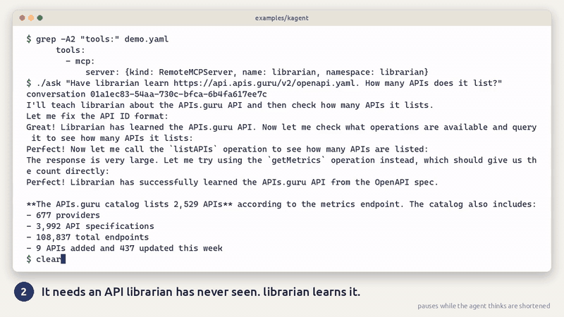

# librarian with kagent, in about ten minutes

A [kagent](https://kagent.dev) agent that holds no credentials reads from an API, and then
asks to change something in it. librarian holds the API's key, knows which Agent is calling
without giving it a key of its own, and asks you before the change is made.

Most of the ten minutes is kagent starting. On a cluster that already runs kagent 1.0 it is
a Helm release, one manifest and two questions.

<p align="center"><a href="https://librarian-agent.com/#run"><picture>
<source media="(prefers-color-scheme: dark)" srcset="https://raw.githubusercontent.com/kultar/librarian/main/site/assets/demo/kagent-change-dark.gif">

</picture></a></p>

This is step 4 below, from a real run. [The full minute](https://librarian-agent.com/#run)
has the rest: the agent's one tool server, an API learned on the spot, and who called.

## You need

- `kubectl`, `helm` and the `kagent` CLI
  ([kagent's installation guide](https://kagent.dev/docs/kagent/1.x/setup/installation/))
- this folder: `git clone https://github.com/kultar/librarian && cd librarian/examples/kagent`
- a cluster with kagent 1.0 on Agent Substrate. If you have none, make one with
  [kind](https://kind.sigs.k8s.io):

```bash
kind create cluster --name librarian-kagent --image kindest/node:v1.37.0
export ANTHROPIC_API_KEY=...          # or another provider's key: kagent install --help
kagent install --provider Anthropic
```

kind makes the new cluster your current context. Agent Substrate needs Kubernetes 1.37, as
kagent's guide says (on 1.35 it runs with feature gates switched on:
[this config](../../tests/integration/substrate/kind-config.yaml)). The key is for the model
kagent's agents think with; librarian needs no model here.

## 1. Install librarian

```bash
helm install librarian oci://ghcr.io/kultar/charts/librarian --version 0.23.2 \
  --namespace librarian --create-namespace -f values.yaml
kubectl -n librarian rollout status deploy/librarian
kubectl -n librarian get remotemcpservers
# NAME        PROTOCOL          URL                                                     ACCEPTED
# librarian   STREAMABLE_HTTP   http://librarian.librarian.svc.cluster.local:8080/mcp   True
```

[`values.yaml`](values.yaml) is short. What matters in it:

```yaml
substrate:
  enabled: true                       # accept kagent's agents, and register with kagent
  rules:
    - match: {namespace: kagent, name: librarian-demo}
      write_apis: [demo]              # may ask for changes there; a person decides each one
      owner: you@example.com          # that person
```

The chart registers librarian with kagent as a `RemoteMCPServer`, the line you see above. Any
Agent can name it under its tools; only an Agent that a rule matches is let in.

The rest of the file is for a laptop: where the demo API's entry comes from, its keys, and
a console with no sign-in. Do not use it on a cluster other people can reach.

## 2. A demo API and an agent

```bash
kubectl apply -f demo.yaml
kubectl -n kagent wait agent/librarian-demo --for=condition=Ready --timeout=5m
```

[`demo.yaml`](demo.yaml) holds a stand-in for an internal API that needs a key, and the Agent.
These are the lines that give a kagent Agent librarian:

```yaml
      tools:
        - mcp:
            server: {kind: RemoteMCPServer, name: librarian, namespace: librarian}
      skills:                         # optional: how to use the tools well
        - name: librarian
          source:
            oci: ghcr.io/kultar/librarian@sha256:159bb5cc...
            path: skills/librarian
```

There is no key, no secret and no egress rule to write: kagent lets the agent reach
librarian, and the platform signs its calls.

## 3. Ask the agent

Forward kagent's controller (the `kagent` CLI talks to it) and librarian's pages:

```bash
kubectl -n kagent port-forward svc/kagent-controller 8083:8083 > /dev/null &
kubectl -n librarian port-forward svc/librarian 8081:8081 > /dev/null &
```

Then ask:

```bash
./ask "What does record 42 of the demo API say?"
```

The agent's answer appears as it writes it: what the demo API returned (it echoes the
request it was sent). Three things happened on the way, and librarian's log shows them:

```bash
kubectl -n librarian logs deploy/librarian -c librarian | grep -e "calling as" -e '"audit"'
# INFO librarian.actors: substrate actor/kagent/session-01a1ec29-... is calling as agent
#   'kagent/librarian-demo'
# {"audit": {"ts": "...", "event": "call", "caller": "kagent/librarian-demo", "api": "demo",
#            "operation": "getRecord", "status_code": 200, ...}}
```

1. The agent's sandbox sent the call with no credential. Agent Substrate's gateway signed
   it for that session.
2. librarian checked the signature against the cluster's issuer and asked kagent which Agent
   the session belongs to: `kagent/librarian-demo`.
3. The rule for that Agent allowed the read, and librarian made it with the key only it
   holds.

Open <http://localhost:8081>: the console shows the read under *Recent activity*.

## 4. A change waits for you

```bash
./ask "Add the comment 'Looks good' to record 42 of the demo API."
```

The agent asks librarian for the write, says that it waits for a person, and waits for the
decision for up to 45 seconds. Nothing has been sent to the API yet. While it waits:

1. Reload <http://localhost:8081>. Under *Waiting on a person* there is one line: a write to
   Demo API, `addComment`, by `kagent/librarian-demo`. Choose **Decide**.
2. The page shows the request as it will be sent: the operation, the record, the body, the
   agent's reason, and who is asking. The agent runs for nobody in particular, so the
   requester is the rule's `owner`.
3. Choose **Approve this write**.

librarian sends the write, and the agent's answer arrives in your terminal: done, HTTP 200.

Were you slower than the agent's wait, or did it stop without waiting? It says that the
write waits for approval. Approve it, then ask in the same conversation (`./ask` printed its
id):

```bash
SESSION=<id> ./ask "Has it been approved?"
```

**Approve and allow similar** saves a grant instead. As the page offers it, a comment on
that record by this Agent then runs without asking for 7 days, in any of its conversations;
untick `id` to allow it for every record. The console's *Grants* page shows the grant and
takes it back.

## Clean up

```bash
kill %1 %2                                        # the two port-forwards
kind delete cluster --name librarian-kagent       # if you made the cluster for this
```

On a cluster you keep:

```bash
kubectl delete -f demo.yaml
helm uninstall librarian --namespace librarian
kubectl delete namespace librarian
```

## Next

- **Your own agents.** Add the `tools` lines to an Agent and a rule for it to librarian's
  values: [Agent Substrate and kagent](../../docs/integrations.md#agent-substrate-and-kagent)
  has the rules, what kagent can and cannot tell librarian about the person, and the limits.
- **An API nobody set up.** The agent's sandbox can reach nothing but librarian, and
  librarian learns an API when an agent needs it:

  ```bash
  ./ask "Have librarian learn https://api.apis.guru/v2/openapi.yaml. How many APIs does it list?"
  ```

  It can be read from at once, and shows on the console for a person to review. Where an
  API needs a key, a person types it into a page: steps 2 and 3 of
  [getting started](../../docs/getting-started.md).
- **A cluster other people use.** Sign-in for approvers, Slack, Postgres:
  [deploy](../../docs/deploy.md).
- **More of kagent.** Plans of several writes, an agent with only some of the tools, kagent's
  own approval in front of librarian's, and the refusals:
  [the longer run](../../tests/integration/substrate).
- **Something was refused.** kagent says only "Forbidden"; librarian's log says why:
  [troubleshooting](../../docs/troubleshooting.md#agent-substrate-and-kagent).

## How this is tested

By hand. No automated run covers it, because it needs a cluster with Agent Substrate and a
key for a model. It was last run from an empty kind cluster on 2026-11-17, with librarian
0.23.1 as published, kagent 1.0.1 (Agent Substrate 1.0.0), kind 0.33 and Kubernetes 1.37.0:
a little over a minute for the cluster, three for kagent, a minute for steps 1 and 2, and
seconds for each question. Each step on this page was run, the clean-up included.
[How kagent support is tested](../../docs/integrations.md#how-this-is-tested) says what runs
with every commit and what does not.

The clip on this page and the video on the site were recorded the same day, on a build of
what was then released as 0.23.2. Nothing in them is re-enacted: the terminal is
drawn from what a real shell printed, and the browser is a headless Chrome on librarian's
own pages, clicked with real input events (the pointer is drawn in, because a headless
browser shows none). Pauses in which the model thinks are cut to 0.7 seconds.
